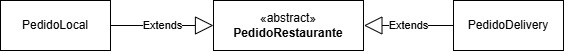

# Template Method — Sistema de Pedidos de Restaurante

## Sobre a atividade

O projeto representa pedidos realizados em um restaurante. Existem duas modalidades: consumo no estabelecimento e entrega ao cliente. Apesar das diferenças no cálculo das taxas, os pedidos compartilham uma estrutura de informações e seguem o mesmo processo para apresentar seus dados.

## Regras do sistema

- Todo pedido possui número, cliente e valor dos produtos.
- O número do pedido deve ser positivo.
- O nome do cliente não pode ser vazio.
- O valor dos produtos deve ser maior que zero.
- O pedido local cobra taxa de serviço de 10% sobre o valor dos produtos.
- O pedido delivery cobra taxa fixa de R$ 8,00 e não cobra taxa de serviço.
- O valor total corresponde ao subtotal somado à taxa específica da modalidade.

## Aplicação do padrão

A classe abstrata `PedidoRestaurante` concentra os atributos e comportamentos comuns. O método `calcularTaxa()` é abstrato e fica sob responsabilidade das subclasses.

O método `getInfo()` funciona como Template Method: define a sequência utilizada para montar as informações do pedido e chama métodos que fornecem os valores correspondentes à modalidade. Ele foi declarado como `final` para que as subclasses não alterem essa sequência.

- `PedidoLocal`: calcula 10% de taxa de serviço.
- `PedidoDelivery`: aplica a taxa fixa de entrega.

## Estrutura

- `PedidoRestaurante`: classe abstrata que define a estrutura comum e o método template.
- `PedidoLocal`: implementação para consumo no estabelecimento.
- `PedidoDelivery`: implementação para entrega.
- `PedidoLocalTest`: testes das regras de cálculo, validações e do método template.

## Diagrama de classes
